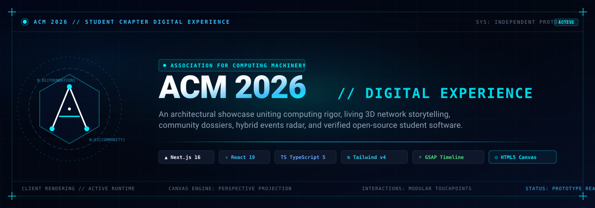

<div align="center">



<br />

[](https://nextjs.org/)
[](https://react.dev/)
[](https://www.typescriptlang.org/)
[](https://tailwindcss.com/)
[](https://greensock.com/gsap/)

<br />

**CYRQORA // Digital Experience Prototype**<br />
*An independent digital-platform prototype exploring modern web architecture, interactive graphics, and narrative community storytelling for computing students.*

</div>

<br />

> [!NOTE]
> **Independent Prototype Notice**: This project is an independent engineering exploration and conceptual digital prototype. It is not an official publication of, owned by, or authorized by any external organization. All trademarks belong to their respective holders.

---

## Overview

**CYRQORA** is an independent, client-side web application prototype exploring what an accessible, publication-grade digital experience looks like for an academic computing society.

Rather than relying on generic landing page templates, this prototype establishes a restrained cyber-editorial aesthetic that unites narrative pacing, real-time client canvas graphics, and accessibility best practices.

### Why It Exists

Collegiate computing societies frequently struggle with fragmented resources, illegible visual clutter, and inaccessible interactive components. CYRQORA explores how an academic community web platform can achieve:

- **Scientific & Editorial Identity:** High-contrast dark typography, structured data hierarchy, and intentional narrative pacing.
- **Lightweight Interactive Graphics:** Custom 3D perspective projection rendered on native HTML5 Canvas without heavy external 3D libraries.
- **Accessibility-First Engineering:** Modals engineered with cyclic `Tab`/`Shift+Tab` focus traps, `Escape` key dismissal, focus restoration, and dynamic OS-level reduced-motion adaptation.

---

## Core Capabilities

- **Living Network Canvas:** Zero-dependency 3D perspective projection engine on native HTML5 2D canvas, simulating dynamic node clusters with distance-decaying connection rays.
- **Paced Narrative Storytelling:** Scroll-driven narrative beats orchestrated via GSAP ScrollTrigger on desktop viewports, automatically adapting to a static sequential flow on mobile or when reduced motion is preferred.
- **Accessible Modal Dossiers:** Comprehensive dialogs for events, member profiles, and chapter reviews featuring keyboard traps, backdrop dismissal, body scroll locks, and reliable focus restoration.
- **Hybrid Event Radar:** Structured workshop and symposium schedule with learning outcomes, prerequisite tracking, and past session visual archive records.
- **Student Software Blueprints:** Curated technical project briefs showcasing systems software, compilers, and algorithmic benchmark suites.
- **Transparent Senior Review Drawer:** Built-in presentation guide classifying genuine external links, client-side rendering engines, and sample records.

---

## Tech Stack

| Technology | Role | Selection Rationale |
| :--- | :--- | :--- |
| **Next.js 16 (App Router)** | Framework | Prerendered static pages, modern server/client component boundaries. |
| **React 19** | UI Library | Concurrent rendering primitives and state synchronization. |
| **TypeScript 5 (Strict)** | Language | End-to-end type safety across schemas, state, and vector coordinates. |
| **Tailwind CSS v4** | Styling | Fast compilation, modern CSS tokens, and responsive utility styling. |
| **GSAP 3 + ScrollTrigger** | Animation | Controlled timeline scrubbing, responsive breakpoints, and matchMedia queries. |
| **HTML5 2D Canvas** | Graphics | Native matrix math and perspective projection with zero external 3D dependencies. |

---

## Prototype Status & Limitations

- **Client-Side Runtime:** This application is a client-orchestrated prototype. There is currently no live backend database, server action, or CMS attached.
- **Illustrative Data:** Member profiles, event schedules, and session briefs are illustrative demonstration records designed to showcase layout hierarchy.
- **Prototype Intake:** Membership and workshop application forms operate in local component state to demonstrate UI transitions; submissions are not posted to external endpoints.
- **Zero Configuration Required:** The application runs out of the box with no environment variables or `.env` files required.

---

## Installation & Setup

### 1. Clone the Repository

```bash
git clone https://github.com/pranjalisantani/cyrqora.git cyrqora
cd cyrqora
```

### 2. Install Dependencies

```bash
npm install
```

### 3. Start Development Server

```bash
npm run dev
```

Open [http://localhost:3000](http://localhost:3000) to view the application.

---

## Development Commands

| Command | Action |
| :--- | :--- |
| `npm run dev` | Boots local development server with Turbopack hot reloading. |
| `npm run build` | Compiles the production bundle and prerenders static routes. |
| `npm run start` | Serves the compiled production build locally. |
| `npm run lint` | Runs ESLint 9 validation across all project files. |
| `npm run type-check` | Runs the TypeScript compiler (`tsc --noEmit`) to verify strict type safety. |

---

## Terms & Disclaimer

**CYRQORA** is an independent digital-platform prototype developed by [Pranjali Santani](https://github.com/pranjalisantani) to explore accessible community web architecture.

*This project is an independent educational and architectural prototype. All product names, logos, and brands are property of their respective owners.*
