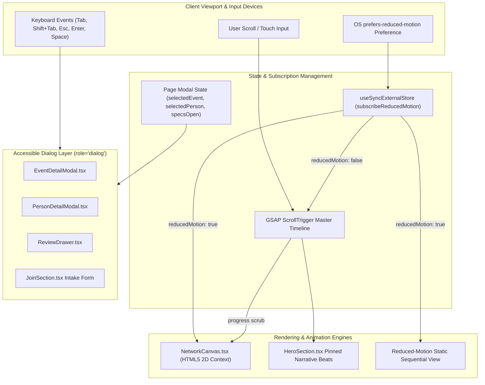
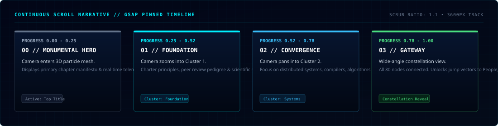

<div align="center">


<br />

[](https://nextjs.org/)
[](https://react.dev/)
[](https://www.typescriptlang.org/)
[](https://tailwindcss.com/)
[](https://greensock.com/gsap/)
[](#6-architecture-overview)

<br />

**An independent digital-platform prototype exploring a modern, accessible web experience for student computing communities.**<br />
*Uniting scientific computing visual metaphors, native 60 FPS HTML5 3D network storytelling, interactive community dossiers, hybrid event radar, and open student software blueprints.*

---

[Project Overview](#1-project-overview) •
[Problem & Motivation](#2-problem-and-motivation) •
[Project Goals](#3-project-goals) •
[Features & Implementation Status](#4-features-and-implementation-status) •
[Technology Stack](#5-technology-stack) •
[Architecture Overview](#6-architecture-overview) •
[Project Structure](#7-project-structure) •
[Prerequisites](#8-prerequisites) •
[Installation & Setup](#9-installation-and-setup) •
[Environment Variables](#10-environment-variables-and-configuration) •
[Development Commands](#11-development-commands) •
[Production & Deployment](#12-production-build-and-deployment-considerations) •
[Known Limitations](#13-known-limitations) •
[Future Scope](#14-future-scope) •
[Contribution Guidance](#15-contribution-guidance) •
[Terms & Disclaimer](#16-terms-and-disclaimer)

---

</div>

<br />

> [!NOTE]
> **Independent Prototype Notice**: This project is an independent engineering exploration and conceptual digital prototype. It is not an official publication of, owned by, or authorized by the global Association for Computing Machinery (ACM). All trademarks belong to their respective holders.

<br />

## 1. Project Overview

The **ACM 2026 Digital Experience** is an independent, client-side web application prototype engineered to explore what a high-quality, editorial digital platform can look and feel like for an academic computing community.

Rather than relying on cookie-cutter SaaS templates or illegible "hacker" neon tropes, this prototype establishes an immersive, restrained cyber-editorial aesthetic. It demonstrates how complex technical organizations can present their mission, people, workshops, projects, and membership pipelines through cohesive visual narrative, native graphics rendering, and rigorous accessibility standards.

Key architectural highlights include:
- **Zero-Dependency 3D Canvas:** Lightweight custom matrix perspective math rendered on native HTML5 2D canvas at 60 FPS without heavy external 3D libraries.
- **Continuous Scroll Storytelling:** A pinned GSAP ScrollTrigger timeline orchestrating three thematic beats across 3600px of scroll travel on desktop viewports.
- **Accessible Dialog Subsystem:** Modal dossiers for members and events featuring strict `Tab`/`Shift+Tab` focus trapping, `Escape` key dismissal, backdrop dismissals, and guaranteed focus restoration to the triggering element.
- **Dynamic Reduced-Motion Engine:** Full support for `prefers-reduced-motion` via React 19's `useSyncExternalStore` and runtime `matchMedia` change listeners, seamlessly substituting pinned scroll with a clean, sequential reading layout.

<br />

---

## 2. Problem and Motivation

### The Status Quo
Collegiate computer science societies and student computing chapters frequently face common digital presentation challenges:
1. **Generic Templates:** Portals often resort to generic bootstrap themes or landing page generators that fail to convey scientific rigor or organizational depth.
2. **Fragmented Information:** Schedules, resources, member directories, and project links are scattered across Discord announcements, Google Drive folders, and unindexed social posts.
3. **Decorative Clutter Over Usability:** When custom designs are attempted, they often suffer from overwhelming neon contrast, unoptimized canvas animations that drain CPU/battery, broken mobile touch ergonomics, and complete absence of keyboard accessibility.

### The Motivation
This repository was conceived to prove that an academic computing organization's digital experience can achieve the engineering polish, typographic hierarchy, and visual storytelling of a premier technical publication while maintaining:
- Engineered with WCAG 2.1 AA accessibility principles in mind (keyboard-trapped dialogs, focus restoration, and dynamic reduced-motion adaptation).
- Lightweight bundle size and performance (zero Three.js/WebGL runtime overhead).
- Complete honesty regarding implemented client-side algorithms versus illustrative prototype content.

<br />

---

## 3. Project Goals

1. **Establish an Editorial Visual Identity:** Deliver a high-contrast, dark-mode visual system anchored in deep blue-black hues (`#020512`), precise cyan accents (`#00f0ff`), restrained typography, and functional grid patterns.
2. **Native High-Performance Canvas Graphics:** Implement real-time 3D particle clustering and depth-attenuated connection physics directly in HTML5 Canvas.
3. **Accessibility as a First-Class Requirement:** Ensure all modals, interactive drawers, and card triggers are fully operable via keyboard (`Enter`, `Space`, `Tab`, `Escape`) with focus preservation and comprehensive reduced-motion support.
4. **Architectural Transparency:** Provide an integrated review drawer that transparently classifies genuine external affiliations, client-side interactive engines, illustrative demo records, and prototype interactions.
5. **Modular & Maintainable Codebase:** Maintain strict TypeScript typing, zero ESLint warnings, modern Next.js 16 App Router conventions, and a clean component hierarchy.

<br />

---

## 4. Features and Implementation Status

To ensure engineering integrity, all capabilities within this repository are explicitly categorized across four operational tiers:

| Category | Definition |
| :--- | :--- |
| **Implemented Functionality** | Fully engineered, working client-side code running live in the browser. |
| **Demonstration / Sample Content** | Curated sample records illustrating data schemas, layout hierarchy, and formatting until ratified by official committee data. |
| **Prototype Interaction** | Functional interactive UI patterns operating in local component state without an active backend database or webhook. |
| **Planned Feature** | Identified roadmap item scheduled for future backend or API integration. |

<br />

### Comprehensive Feature Matrix

| Feature / Module | Component File | Status | Description & Engineering Details |
| :--- | :--- | :--- | :--- |
| **Living 3D Network Engine** | `NetworkCanvas.tsx` | **Implemented Functionality** | Native HTML5 canvas rendering 80 nodes across 4 spatial clusters. Computes 3D perspective projection, velocity physics, proximity connection rays, mouse parallax, and depth fog. |
| **Continuous Scroll Hero** | `HeroSection.tsx` | **Implemented Functionality** | Pinned 3-beat narrative scrub (Foundation, Convergence, Community) driven by a master GSAP ScrollTrigger timeline over 3600px of scroll travel. |
| **Touch & Mobile Narrative** | `HeroSection.tsx` | **Implemented Functionality** | Evaluated via `gsap.matchMedia("(max-width: 1023px)")`. Eliminates scroll pinning on mobile to prevent gesture conflicts, presenting progressive editorial cards. |
| **Dynamic Reduced-Motion Engine** | `HeroSection.tsx`, `NetworkCanvas.tsx`, `FeaturedProjects.tsx`, `WhatWeDoPreview.tsx` | **Implemented Functionality** | Synchronizes via `useSyncExternalStore` and `matchMedia` change listeners. Automatically halts 60 FPS canvas loop, destroys GSAP pin triggers via `mm.revert()`, and presents an accessible static reading layout. |
| **Modal Focus Trap & Restoration** | `EventDetailModal.tsx`, `PersonDetailModal.tsx`, `ReviewDrawer.tsx`, `JoinSection.tsx` | **Implemented Functionality** | Robust dialog subsystem. Traps `Tab`/`Shift+Tab` strictly within active surface, dismisses on `Escape` or backdrop click, locks body scroll, and restores focus to the exact triggering element. |
| **Card Keyboard Navigation** | `EventsSection.tsx`, `PeopleSection.tsx` | **Implemented Functionality** | Cards configured with `role="button"`, `tabIndex={0}`, accessible `aria-label`, and `Enter`/`Space` activation with `e.target !== e.currentTarget` guards preventing nested event bubbling. |
| **People Constellation** | `PeopleSection.tsx` | **Demonstration / Sample Content** | Structured member roster across Executive Core, Technical Leads, Research Associates, and Alumni. Member names, bios, and affiliations are illustrative sample records. |
| **Person Profile Dossier** | `PersonDetailModal.tsx` | **Implemented Functionality** | Slideout modal presenting member details, past chapter responsibilities, verified external social links, and research interests. |
| **Events & Workshop Radar** | `EventsSection.tsx` | **Demonstration / Sample Content** | Hybrid, in-person, and virtual event schedule (Symposia, Hackathons, ICPC Clinics). Event titles, dates, and syllabi are curated sample records. |
| **Event Syllabus & Photo Dossier** | `EventDetailModal.tsx` | **Implemented Functionality** | Modal displaying event category, learning outcomes, syllabus breakdown, speaker information, and embedded photo records for past events. |
| **Chapter Pillars** | `WhatWeDoPreview.tsx` | **Demonstration / Sample Content** | 4-column overview of chapter initiatives: Hands-on Workshops, Chapter Projects, Research Reading Groups, and Hackathons. |
| **Selected Student Software** | `FeaturedProjects.tsx` | **Demonstration / Sample Content** | Project blueprints and architectural briefs illustrating chapter software initiatives (Distributed Key-Value Store, Neural Inference Engine, Algorithmic Benchmark Suite). |
| **Membership Intake Portal** | `JoinSection.tsx` | **Prototype Interaction** | Client-side application intake modal. Allows entering name, email, and interest area; transitions to an "INTEREST SIGNAL RECORDED" state. Not connected to a live database or Google Form webhook. |
| **Senior Review & Spec Drawer** | `ReviewDrawer.tsx` | **Implemented Functionality** | Architectural walkthrough slideout accessible from the navbar ("Senior Guide ↗"). Formally audits genuine external links vs sample content vs prototype interactions. |
| **Sticky Navigation Bar** | `Navbar.tsx` | **Implemented Functionality** | Fixed navigation with scroll-dependent backdrop blur, section anchor links, and mobile hamburger menu. |
| **Production Footer Directory** | `Footer.tsx` | **Implemented Functionality** | Footer directory containing verified external links to official ACM headquarters resources (`acm.org`, `dl.acm.org`, `acm.org/chapters`, `acm.org/code-of-ethics`). |
| **Backend Data Persistence** | — | **Planned Feature** | Planned integration with a server-side database (PostgreSQL / Supabase) and Next.js server actions for real membership intake. |
| **Calendar Provider Sync** | — | **Planned Feature** | Planned API synchronization with Google Calendar, Luma, or Devfolio for dynamic event scheduling. |

<br />

---

## 5. Technology Stack

```
Runtime: Node.js (v20+)
Framework: Next.js 16.3.5 (App Router, Turbopack / Webpack)
UI Library: React 19.2.8
Language: TypeScript 5.x (Strict Mode)
Styling: Tailwind CSS v4 (@tailwindcss/postcss)
Animation: GSAP 3.15.0 + ScrollTrigger
Graphics: Native HTML5 2D Canvas with 3D Perspective Math
Linting: ESLint 9 (Flat Config, eslint-config-next)
```

### Detailed Tooling Rationale

| Dependency | Version | Architectural Purpose & Selection Rationale |
| :--- | :--- | :--- |
| **`next`** | `16.3.5` | Next.js App Router provides optimal static prerendering, modern React Server Component architecture, and production route optimization. |
| **`react`** / **`react-dom`** | `19.2.8` | React 19 provides modern state synchronization, concurrent rendering primitives, and clean hook integrations. |
| **`typescript`** | `^5` | Strict type checking across event schemas, member rosters, canvas 3D vector coordinates, and modal lifecycle states. |
| **`tailwindcss`** | `^4` | Tailwind CSS v4 eliminates runtime CSS-in-JS overhead, utilizing `@tailwindcss/postcss` for lightning-fast compilation of utility tokens and glassmorphism. |
| **`gsap`** | `^3.15.0` | GreenSock Animation Platform and ScrollTrigger provide precise timeline scrubbing, responsive `matchMedia` breakpoints, and robust cleanup via `ctx.revert()`. |
| **HTML5 Canvas** | Native | Eliminates hundreds of kilobytes of WebGL/Three.js bundle weight by projecting 3D point clusters (`X, Y, Z`) directly onto a native 2D canvas context via trigonometric perspective formulas. |
| **`eslint`** / **`eslint-config-next`** | `^9` / `16.3.5` | Enforces modern React Compiler ref access rules, hook dependency integrity, and JSX accessibility. |

<br />

---

## 6. Architecture Overview

The application follows a modular, client-orchestrated architecture where the main page (`app/page.tsx`) acts as the state coordinator for section anchors, responsive viewports, and modal dialogs.

<div align="center">
  
</div>

<br />

### Runtime Interaction & Data Flow



<br />

### Core Technical Subsystems

#### 1. 3D Perspective Canvas Engine (`NetworkCanvas.tsx`)
Rather than pulling in WebGL or Three.js, `NetworkCanvas` executes perspective division on an array of 80 3D particle nodes:
```typescript
// 3D coordinate projection to 2D screen coordinates
const scale = camera.fov / rz; // Perspective scale
const sx = cx + rx * scale;     // Screen X
const sy = cy + ry * scale;     // Screen Y
```
- **Spatial Clusters:** Nodes are partitioned into 4 spatial hubs: *Ambient Drift* (`0, 0, 0`), *Foundation* (`-40, -20, 180`), *Systems* (`70, 30, 520`), and *Impact* (`-30, 10, 840`).
- **Depth Fog & Near Fade:** Particle radii and connection line opacity attenuate based on camera Z-distance, producing depth cues without complex shader pipelines.
- **Dynamic Framerate Adaptation:** In standard mode, updates run via `requestAnimationFrame` at 60 FPS; when reduced motion is detected, particle velocity is set to zero, the animation frame loop is halted, and a single static perspective frame is drawn.

#### 2. Master Storytelling Timeline (`HeroSection.tsx`)
On desktop viewports (`min-width: 1024px`), the hero container pins across a 3600px scroll track:
- **Beat 0 (Identity):** Hero manifesto fades and dissolves upward (`progress: 0.00 -> 0.25`).
- **Beat 1 (Foundation):** Camera shifts focus into Cluster 1, highlighting scientific inquiry (`progress: 0.25 -> 0.52`).
- **Beat 2 (Convergence):** Camera swings laterally into Cluster 2, emphasizing distributed systems and compilers (`progress: 0.52 -> 0.78`).
- **Beat 3 (Community):** Camera pulls back to reveal the connected constellation and navigates toward content sections (`progress: 0.78 -> 1.00`).
- **Mobile Fallback:** On viewports below `1024px`, scroll pinning is automatically bypassed via `gsap.matchMedia`, presenting progressive scroll-triggered cards.

<div align="center">
  
</div>

<br />

#### 3. Focus Management & Dialog Subsystem
All modals (`EventDetailModal`, `PersonDetailModal`, `ReviewDrawer`, `JoinSection`) share a hardened lifecycle architecture:
- **State Transition Tracking:** A `wasOpenRef` ensures `previousFocusRef` captures the active document element only on closed-to-open transitions.
- **Inline Prop Stabilization:** `onClose` is captured via `onCloseRef` inside an effect, preventing inline callback updates from re-triggering cleanup or prematurely releasing focus.
- **Strict Keyboard Trapping:** Queries all focusable elements matching `'button:not([disabled]), [href], input:not([disabled]), select:not([disabled]), textarea:not([disabled]), [tabindex]:not([tabindex="-1"])'`. If `Tab` or `Shift+Tab` reaches boundary elements, focus wraps cyclically within the modal container.
- **Multi-Vector Dismissal:** Handles `Escape` key (with `e.stopPropagation()`), close buttons, and backdrop clicks. On closure, `document.body.style.overflow` is unlocked and focus is restored to the triggering button.

<br />

---

## 7. Project Structure

```
acm-2026-digital-experience/
├── .gitignore                       # Git ignore rules (node_modules, .next, .env*, build artifacts)
├── AGENTS.md                        # Next.js agent operational rules
├── CLAUDE.md                        # Project operational pointers
├── eslint.config.mjs                # ESLint 9 Flat Config (Next.js core-web-vitals & typescript-eslint)
├── next.config.ts                   # Next.js configuration
├── package.json                     # Package metadata, dependencies, and npm scripts
├── postcss.config.mjs               # PostCSS configuration for Tailwind CSS v4
├── README.md                        # Comprehensive project engineering documentation
├── tsconfig.json                    # TypeScript strict compiler configuration
│
├── app/                             # Next.js App Router directory
│   ├── favicon.ico                  # Application favicon
│   ├── globals.css                  # Tailwind v4 import, custom grid tokens, and reduced-motion rules
│   ├── layout.tsx                   # Root HTML layout, Geist font definitions, and metadata
│   ├── page.tsx                     # Main page orchestrating narrative flow and modal dialogs
│   │
│   └── components/                  # Component library
│       │
│       ├── [ACTIVE CORE COMPONENTS] # Actively imported and rendered in app/page.tsx
│       ├── Navbar.tsx               # Fixed glassmorphic header & senior guide trigger
│       ├── HeroSection.tsx          # Pinned 3-beat storytelling hero & reduced-motion layout
│       ├── NetworkCanvas.tsx        # Native HTML5 3D perspective particle network simulation
│       ├── PeopleSection.tsx        # Categorized member roster with accessible card triggers
│       ├── PersonDetailModal.tsx    # Accessible modal dossier for member profiles
│       ├── EventsSection.tsx        # Hybrid event radar with category filtering
│       ├── EventDetailModal.tsx     # Accessible modal dossier for event syllabi & photos
│       ├── WhatWeDoPreview.tsx      # 4 chapter initiative pillars
│       ├── FeaturedProjects.tsx     # Selected student software blueprints
│       ├── JoinSection.tsx          # Membership action verbs & prototype intake modal
│       ├── Footer.tsx               # Chapter directory and genuine ACM global resource links
│       ├── ReviewDrawer.tsx         # Slideout presentation guide & feature matrix audit
│       │
│       └── [UNIMPORTED PROTOTYPE MODULES] # Retained standalone modules from prior iterations (not mounted in app/page.tsx; no separate routes exist)
│           ├── AboutSection.tsx     # Standalone chapter narrative section
│           ├── ArchiveSection.tsx   # Historical event archive and newsletter listing
│           ├── AudioController.tsx  # Web Audio API ambient synthesizer component
│           ├── BootSequence.tsx     # Retro terminal boot sequence screen
│           ├── CapabilitiesSection.tsx# Technical capabilities showcase
│           ├── ContactSection.tsx   # Standalone contact and inquiry form
│           ├── FeaturedEvents.tsx   # Alternate compact event card layout
│           ├── FeaturedPeople.tsx   # Alternate compact member card layout
│           ├── InformationSection.tsx# Architectural dossier module
│           ├── ProjectsSection.tsx  # Full project schema definitions (exports SAMPLE_PROJECTS)
│           ├── ResourcesSection.tsx # Searchable learning resource directory
│           ├── ThemeProvider.tsx    # Multi-theme context provider
│           └── ThemeToggle.tsx      # Theme toggle button
│
├── docs/                            # Architectural documentation assets
│   └── assets/                      # High-resolution vector diagrams
│       ├── architecture-diagram.svg # Multi-tier system architecture diagram
│       ├── hero-banner.svg          # Presentation hero banner
│       ├── storytelling-flow.svg    # 4-beat continuous scroll scrub diagram
│       └── ui-showcase.svg          # 4-panel interactive UI touchpoints diagram
│
└── public/                          # Static public asset directory
```

> [!NOTE]
> **Active Routing vs. Retained Modules**: The application currently runs as a single-page experience mounted in `app/page.tsx`. Only the active components listed above are rendered on the live route (`/`). The 12 unimported prototype modules are retained in the repository as standalone reference implementations from prior design iterations; no secondary routes or subpages (such as `/archive` or `/resources`) are currently implemented.

<br />

---

## 8. Prerequisites

Before installing and running the project locally, verify that your environment satisfies:

- **Node.js**: `20.x` or later (LTS recommended). Check with `node -v`.
- **Package Manager**: `npm` (`10.x` or later), `pnpm` (`9.x` or later), or `yarn` (`1.22+`).
- **Modern Web Browser**: Chrome, Edge, Firefox, or Safari with support for HTML5 Canvas, CSS Grid, and CSS Backdrop Filters.

<br />

---

## 9. Installation and Setup

### 1. Clone the Repository
```bash
git clone https://github.com/pranjalisantani/acm-2026-digital-experience.git
cd acm-2026-digital-experience
```

### 2. Install Dependencies
Using npm:
```bash
npm install
```
*(Or `pnpm install` / `yarn install` according to your preferred package manager.)*

### 3. Launch Development Server
```bash
npm run dev
```

Open [http://localhost:3000](http://localhost:3000) in your browser. The page will hot-reload automatically upon file changes.

<br />

---

## 10. Environment Variables and Configuration

This application is an independent client-side prototype that runs completely **zero-config**. It consumes no environment variables (`process.env`) and requires no `.env` or `.env.local` files to develop, build, or deploy.

All local environment files (`.env*.local`, `.env`) remain excluded from version control via `.gitignore`.

<br />

---

## 11. Development Commands

The repository provides standard scripts defined in `package.json`:

| Command | Action |
| :--- | :--- |
| `npm run dev` | Starts the Next.js local development server on [http://localhost:3000](http://localhost:3000). |
| `npm run build` | Compiles the production bundle and prerenders static routes. |
| `npm run start` | Boots the compiled Next.js production server. |
| `npm run lint` | Runs ESLint 9 across all project files to validate code standards. |
| `npm run type-check` | Runs the TypeScript compiler (`tsc --noEmit`) to verify strict type safety. |

<br />

---

## 12. Production Build and Deployment Considerations

### Building for Production
```bash
npm run build
```

The Next.js build pipeline statically prerenders the application routes:
- `/` (Static Home Page)
- `/_not-found` (Static 404 Page)

> [!TIP]
> **Windows OneDrive Build Optimization**: In Windows environments syncing with OneDrive, file-system virtualization locks can occasionally trigger transient `EPERM` collisions when multiple worker threads create directories in `.next/`. Running `npx next build --webpack` resolves file-locking by running compilation through standard Webpack streaming.

### Deployment Targets

1. **Vercel (Recommended):**
   - Connect the repository to Vercel.
   - Framework preset: `Next.js`.
   - Build command: `next build`.
   - Output directory: `.next`.
   - Zero additional configuration required.

2. **Netlify:**
   - Deploy using the `@netlify/plugin-nextjs`.
   - Publish directory: `.next`.

3. **Node.js / Containerized Server:**
   - Run `npm run build`, followed by `npm run start` to serve via Node.js on port 3000.
   - For Docker, use standard `node:20-alpine` multi-stage build caching `.next/standalone`.

<br />

---

## 13. Known Limitations

To provide complete clarity to developers and reviewers, the following limitations are documented:

1. **Client-Side Prototype State:** The application currently operates entirely in the browser. There is no active database, ORM, or headless CMS connected.
2. **Mock Membership Intake:** Submissions in the Join Chapter modal (`JoinSection.tsx`) toggle a local `submitted` state and display a confirmation screen. The form payload is not posted to a production endpoint.
3. **Illustrative Sample Data:** Member profiles, event dates, session syllabi, and student software briefs are illustrative records designed to demonstrate layout hierarchy pending live committee ratification.
4. **No Automated E2E Test Suite:** While static verification is thorough (`eslint`, `tsc`, `next build`), end-to-end integration tests (e.g. Playwright / Cypress) are not yet implemented.

<br />

---

## 14. Future Scope

The project architecture is prepared for modular enhancement in upcoming phases:

- [ ] **Phase 1: Backend & Server Actions**
  - Connect `JoinSection.tsx` to a Next.js Server Action with rate limiting and database persistence (Supabase / PostgreSQL).
- [ ] **Phase 2: Live Calendar Synchronization**
  - Integrate Google Calendar, Luma, or Devfolio APIs to synchronize `EventsSection.tsx` with live chapter event schedules.
- [ ] **Phase 3: Headless CMS Integration**
  - Provide a structured CMS schema (Sanity / Strapi) allowing non-technical chapter officers to update event syllabi and member rosters.
- [ ] **Phase 4: Automated Testing & CI/CD**
  - Configure GitHub Actions to automatically run `npm run lint`, `npm run type-check`, and Playwright E2E accessibility tests on every pull request.

<br />

---

## 15. Contribution Guidance

Contributions to improve code quality, documentation, and accessibility are welcomed.

### Development Workflow
1. **Fork & Branch:** Create a feature branch with a descriptive name:
   ```bash
   git checkout -b feature/accessible-enhancement
   ```
2. **Follow Coding Standards:**
   - Adhere strictly to TypeScript strict mode. Do not use `any`.
   - Maintain the existing cyber-editorial design system and color palette.
   - Preserve focus management (`Tab`/`Shift+Tab` traps, `Escape` key listeners, focus restoration).
   - Ensure all animations include `prefers-reduced-motion` alternatives.
3. **Run Pre-Commit Verification:**
   ```bash
   npm run lint
   npm run type-check
   npm run build
   ```
   Ensure all three commands complete with exit code 0 before opening a pull request.

<br />

---

## 16. Terms and Disclaimer

### Project Status & Authorship
This repository is an independent digital-platform prototype developed by [Pranjali Santani](https://github.com/pranjalisantani) to explore accessible community web architecture.

### Trademark & Non-Affiliation Disclaimer
*Association for Computing Machinery, ACM, and the ACM logo are registered trademarks of the Association for Computing Machinery, Inc. This project is an independent educational and architectural prototype developed to explore digital community design. It is not affiliated with, sponsored by, or endorsed by the Association for Computing Machinery.*

<br />

<div align="center">
  <sub>ACM 2026 Digital Experience • Independent Community Platform Prototype</sub>
</div>
